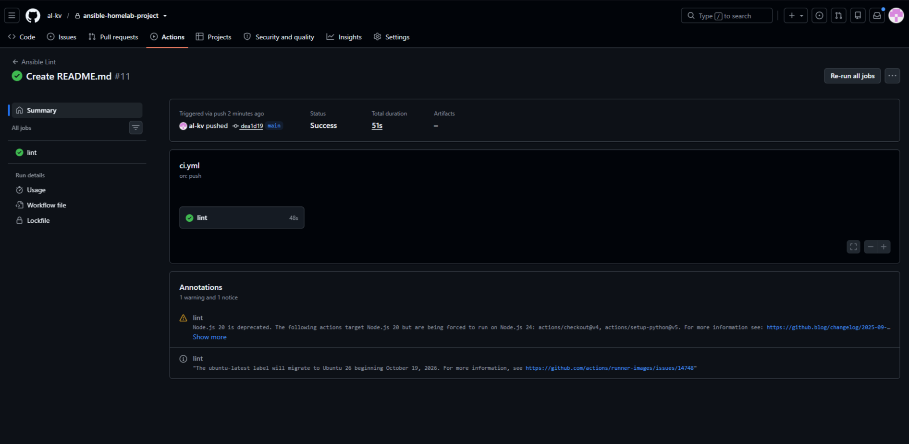
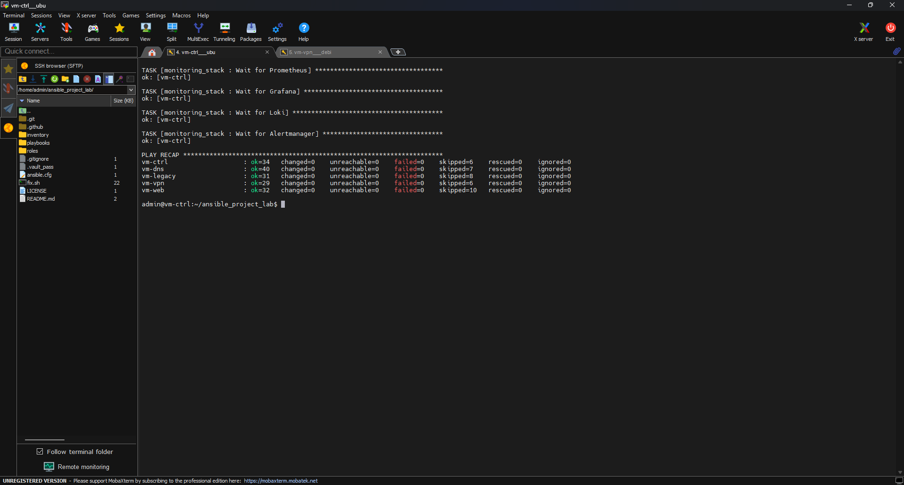
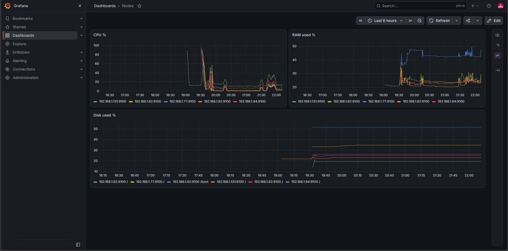
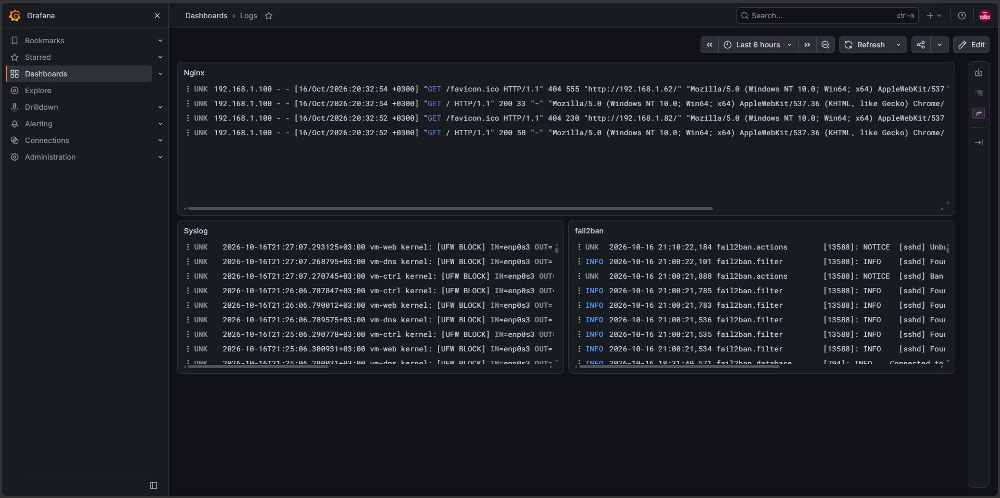
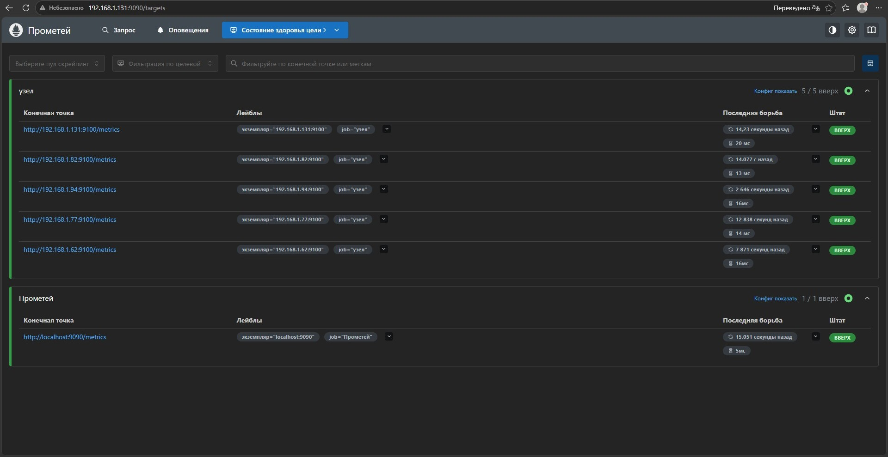
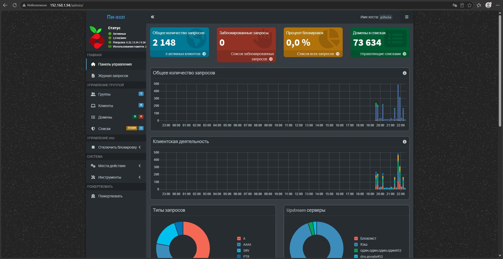
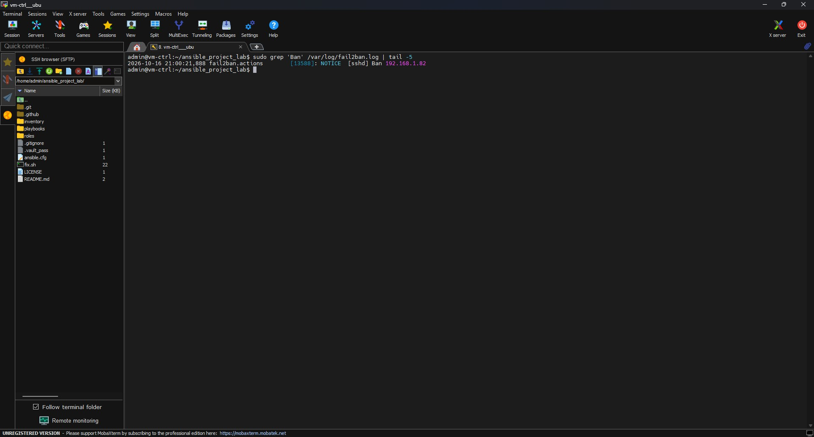

# Ansible Homelab Project


Автоматическое развертывание homelab из 5 виртуальных машин (проект `al-kv`).
Плейбук идемпотентен (`changed=0` при повторном запуске), покрыт проверками `ansible-lint`, `shellcheck` и `hadolint`.

## Стек
- **vm-ctrl** (192.168.1.131): Ansible, Prometheus, Grafana, Alertmanager, Loki, Promtail
- **vm-web** (192.168.1.82): Nginx, node_exporter, promtail, Docker
- **vm-dns** (192.168.1.94): Pi-hole в Docker, node_exporter, promtail
- **vm-vpn** (192.168.1.77): WireGuard, node_exporter, promtail
- **vm-legacy** (192.168.1.62): Nginx (SELinux), dnf-automatic, node_exporter, promtail

## Доказательства работы (Screenshots)

### CI/CD



### Мониторинг (Grafana & Prometheus)




### Pi-hole & Безопасность



---

## Как запустить у себя (Prerequisites)

⚠️ **Внимание:** Репозиторий содержит зашифрованные секреты (Ansible Vault) и настроен под конкретную локальную сеть. Чтобы запустить его у себя, выполните шаги:

### 1. Подготовка окружения
У вас должны быть 5 виртуальных машин с ОС Ubuntu/Debian/Rocky, доступные по SSH.
Отредактируйте файл `inventory/hosts`, указав **свои** IP-адреса и имена пользователей (в репозитории указаны IP `192.168.1.x` и юзеры `admin`, `admin1`, `student`).

Убедитесь, что вы можете зайти на каждую машину по SSH-ключу без пароля.

### 2. Настройка Ansible Vault
Вам нужно создать свой файл с паролем и зашифровать свои секреты:
```bash
echo "ваш_пароль" > .vault_pass
chmod 600 .vault_pass
ansible-vault create inventory/group_vars/all/vault.yml
```
Внесите туда переменные: `vault_pihole_password`, `vault_wg_server_private_key`, `vault_wg_client_public_key`, `vault_telegram_bot_token`, `vault_telegram_chat_id`, `vault_grafana_admin_password`.

### 3. Установка коллекций и запуск
```bash
ansible-galaxy collection install community.general community.docker ansible.posix
ansible-playbook playbooks/site.yml
```

## Проверка идемпотентности
```bash
ansible-playbook playbooks/site.yml
# Повторный запуск должен показать changed=0 на всех VM
```

## CI/CD
Проект использует GitHub Actions для проверки:
- `ansible-lint` (стиль кода и синтаксис)
- `shellcheck` (скрипты Bash)
- `hadolint` (Dockerfile)
